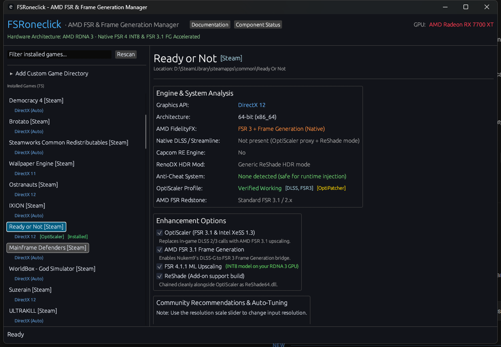

# FSRoneclick

Automated deployment and runtime orchestrator for AMD FSR 3.1 / 4.1.1 "Redstone", Frame Generation, OptiScaler, ReShade, and RenoDX HDR.

[](https://github.com/bbayram-l/fsroneclick/releases)
[](https://github.com/bbayram-l/fsroneclick/actions/workflows/ci.yml)
[](LICENSE)
[](https://github.com/bbayram-l/fsroneclick)
[-success.svg?style=flat-square)](https://github.com/bbayram-l/fsroneclick/releases)

FSRoneclick finds the PC games installed on your machine and, in one click, installs and configures
[OptiScaler](https://github.com/optiscaler/OptiScaler) so that games offering DLSS, XeSS, or FSR 2/3 run AMD FSR 3.1 or
FSR 4 upscaling and FSR Frame Generation instead, on AMD, Intel, and NVIDIA GPUs alike. It can also add ReShade with
RenoDX native HDR and AMD CAS sharpening. Everything it places in a game folder can be removed again with one click.

Inspired by [DLSS5oneclick](https://github.com/faisalkindi/DLSS5oneclick) — see [Acknowledgments](#acknowledgments--credits).



---

## Download & Quick Start (No Rust Required)

FSRoneclick is distributed as a **fully self-contained, pre-compiled Windows executable**. You do **not** need Rust, Cargo, Python, Visual Studio, or any development tools installed.

1. Go to the [**Latest GitHub Release**](https://github.com/bbayram-l/fsroneclick/releases/latest) page.
2. Download **`fsroneclick-vX.Y.Z-windows-x64.zip`** (or download `fsroneclick.exe` directly).
3. Extract the folder anywhere on your computer (e.g. `Downloads` or `Desktop`).
4. Double-click **`fsroneclick.exe`** to launch the application.

> **Windows SmartScreen**: release builds are not code-signed yet, so Windows may show *"Windows protected your PC"*.
> Choose **More info → Run anyway**. You can verify the download against the published `.sha256` file:
> `Get-FileHash .\fsroneclick.exe -Algorithm SHA256`

---

## Requirements

- **Windows 10 or 11, 64-bit.** An internet connection is needed the first time each component is installed;
  downloads are cached and verified for later installs.
- **A 64-bit DirectX 11, DirectX 12, or Vulkan game.** To change the upscaler, the game must offer DLSS, XeSS, or
  FSR 2/3 in its settings: OptiScaler replaces whichever one you pick. Frame generation additionally needs the game's
  DLSS Frame Generation option. ReShade, RenoDX HDR, and CAS sharpening don't depend on either.
- **Any GPU for FSR 3.1.** FSR 4 needs an AMD Radeon RX 7000 (RDNA 3) or RX 9000 (RDNA 4) series GPU.

---

## Before You Start

- **Single-player / offline only for protected games.** FSRoneclick installs DLL proxies (e.g. `dxgi.dll`) into game
  folders. Kernel anti-cheat systems (Easy Anti-Cheat, BattlEye, Vanguard, Ricochet) can block these or flag your
  account. FSRoneclick shows a warning when it detects anti-cheat, but **you are responsible for where you use it**.
- **64-bit games only.** OptiScaler and ReShade64 do not work in 32-bit games, so installs into them are refused.
- **Use at your own risk.** Mods can cause crashes or visual glitches. Uninstall restores the game folder (see
  [What FSRoneclick Changes](#what-fsroneclick-changes-on-your-pc)), and Steam/Epic "Verify files" is always a fallback.

---

## Using FSRoneclick

### Install

1. Open **FSRoneclick**. It scans your Steam libraries, Epic Games Launcher installs, and common game folders in the
   background, and lists what it finds on the left.
   - Game missing? Click **Rescan**, or open **Add Custom Game Directory** and enter the folder that contains the
     game's `.exe` (for example `D:\Games\Far Cry 5\bin`).
2. Select the game and review the **Engine & System Analysis**: graphics API, anti-cheat, the community compatibility
   status, and any recommended workarounds, which FSRoneclick applies automatically.
3. Choose the **Enhancement Options** and click **Install Enhancements**.
4. Launch the game the way you normally do (Steam, Epic, or the game's executable).
5. In the game's **Video / Display** settings:
   - Set the upscaler to **DLSS** (or XeSS / FSR if DLSS isn't offered). OptiScaler runs AMD FSR 3.1 or FSR 4 in its place.
   - If the game has **DLSS Frame Generation**, turn it on to get AMD FSR Frame Generation.

### In-Game Keys

| Key | Action |
|---|---|
| `Insert` | Open the OptiScaler menu (upscaler, sharpness, frame generation, and more) |
| `End` | Turn OptiScaler frame generation on or off |
| `Page Up` / `Page Down` | Show OptiScaler's FPS overlay / cycle its style |
| `Home` | Open the ReShade overlay (shader effects, RenoDX HDR settings) |

### Change Settings or Uninstall

Once a game has enhancements installed, its page shows **Update Configuration**, which re-applies your current
options, and **Uninstall Enhancements**, which removes every file FSRoneclick placed and restores any game file it had
replaced. Close the game before uninstalling.

---

## Key Features

### Automated Detection & Smart Injection
- **Library Scanner**: Finds every Steam library listed in `libraryfolders.vdf` (Steam's install location is read from the registry), Epic Games Launcher installs, and games in common non-store folders (`C:\Games`, `D:\Games`, `E:\Games`, `GOG Games`).
- **Binary Targeting**: Targets the real engine binary inside subdirectories (e.g. `FarCry5.exe` inside `bin\`) rather than launcher wrappers.
- **Hook Strategy Selection**: Installs OptiScaler as the proxy DLL (`dxgi.dll`, `winmm.dll`, `d3d12.dll`, or `version.dll`) the community compatibility list recommends for the game, to avoid launch crashes.
- **Per-Game Tuning**: Generates `OptiScaler.ini` with the game's known workarounds (auto exposure, color space, GPU spoofing, FSR 2 pattern matching) and with the FSR watermarks turned off.

### Hardware-Aware Optimization
- **RDNA 4 / RX 9000**: Upgrades games to FSR 4.1.1 running its native FP8 model (`Fsr4Update`).
- **RDNA 3 / RX 7000**: Upgrades games to FSR 4.1.1 using OptiScaler's INT8 model (`Fsr4Update` + `Fsr4ForceEnableInt8`).
- **Universal Fallback**: Uses FSR 3.1 for RDNA 2, Intel Arc, NVIDIA, and other GPUs.
- The GPU is identified from the display adapter information Windows records; FSR 4 can be switched off in the app.

### Crash Prevention & Vendor-Lock Bypass
- **OptiPatcher Integration**: Deploys `OptiPatcher.asi` (with ASI loading enabled in OptiScaler) for games where the compatibility list marks it as supported, to neutralize vendor checks that crash games when DLSS Frame Generation is enabled on non-RTX GPUs.
- **Companion Libraries**: Stages the supporting runtimes shipped in the OptiScaler package (fakenvapi, dlssg-to-fsr3, AMD FidelityFX and Intel XeSS DLLs, D3D12 Agility SDK).

### Visual Enhancement & HDR
- **ReShade 6.8.0**: Installs the add-on build of ReShade, loaded by OptiScaler alongside FSR.
- **AMD FidelityFX CAS**: Installs the Contrast Adaptive Sharpening ReShade shader, with an embedded copy used when it cannot be downloaded.
- **RenoDX Native HDR**: Matches the game against the live RenoDX mod catalog and installs the game-specific HDR add-on for ReShade.
- **REFramework**: Stages REFramework automatically for Capcom RE Engine games.

### Dynamic Database & Updates
- **Large Compatibility Database**: ~700 titles from the OptiScaler community compatibility list and 400+ titles from AMD's FSR "Redstone" catalog are embedded.
- **Live Sync**: `--update-compat` (or *Sync Compatibility Wiki DB* in the app) downloads and caches the latest OptiScaler compatibility list.
- **Component Status**: `--check-updates` (or *Component Status* in the app) compares the pinned OptiScaler and ReShade builds and FSRoneclick itself against their latest releases, and says *Not checked* when a source can't be reached.

### Verified Downloads
- **OptiScaler and ReShade** are pinned releases checked against SHA-256 checksums built into FSRoneclick.
- **REFramework and OptiPatcher** always use the latest release, checked against the SHA-256 GitHub publishes for it; a new upstream build is picked up automatically, and a previously verified copy is used when GitHub can't be reached.
- Files are only installed from an archive that passed verification and was extracted completely. A download that fails verification is deleted: the install stops if it was OptiScaler or ReShade, and REFramework or OptiPatcher are skipped with a warning in the log.
- RenoDX add-ons and ReShade shader headers have no published checksums. They are only fetched over HTTPS from GitHub, and RenoDX add-ons are refreshed on every install.

### Safe & Non-Destructive
- **Manifest-Driven Clean Rollback**: Every placed file is recorded in `.fsroneclick-manifest` as it is written, so even an interrupted install can be undone. Uninstall removes only those files.
- **Original Files Preserved**: If a game already ships a file FSRoneclick needs to replace (for example its own `amd_fidelityfx_dx12.dll`), the original is kept as `<name>.fsroneclick-backup` and restored on uninstall.
- **Safe to Retry**: If a file is in use (the game is still running), uninstall says so and keeps it in the manifest; close the game and uninstall again.

---

## What FSRoneclick Changes on Your PC

| Location | What | Undone by uninstall? |
|---|---|---|
| Game executable folder | Proxy DLL, OptiScaler runtimes and `OptiScaler.ini`, `ReShade64.dll` and `ReShade.ini`, `reshade-shaders\`, `plugins\OptiPatcher.asi`, RenoDX add-on, `dinput8.dll` (RE Engine), `.fsroneclick-manifest` | Yes — files are removed and any replaced originals restored |
| `%LOCALAPPDATA%\FSRoneclick\cache` | Downloaded archives, extracted packages, cached compatibility list | No — delete the folder to reclaim space |
| `HKCU\Software\Microsoft\DirectX\UserGpuPreferences` | Sets the game to the *High performance* GPU (the same setting as Windows *Graphics settings*) | No — change it in Windows *Settings → Display → Graphics* |

Downloads come from GitHub (OptiScaler, OptiPatcher, REFramework, RenoDX, shaders) and reshade.me (see [Verified Downloads](#verified-downloads)).

---

## Command Line Interface (CLI)

FSRoneclick can also be run from a terminal for scripting or automation. Without arguments it opens the app.
Commands exit with code `0` on success and `1` on failure.

```bash
# List all detected games and their installation status
fsroneclick.exe --list-games

# Inspect a game directory or executable (graphics API, DLSS, anti-cheat, RenoDX, compatibility)
fsroneclick.exe --check "D:\Games\Far Cry 5\bin"

# Install FSR and enhancements for a specific game directory
fsroneclick.exe --install "D:\Games\Far Cry 5\bin"

# Uninstall injected files and restore stock game state
fsroneclick.exe --remove "D:\Games\Far Cry 5\bin"

# Show component versions and check for newer OptiScaler, ReShade, and FSRoneclick releases
fsroneclick.exe --check-updates

# Synchronize local compatibility database with upstream community sources
fsroneclick.exe --update-compat
```

---

## Troubleshooting

- **A game isn't listed.** Click **Rescan**. Games outside Steam, Epic, and the common game folders can be added
  with **Add Custom Game Directory** (or installed directly with `--install <folder>`).
- **The game crashes at launch, or nothing changes in-game.** Uninstall restores the game folder. Check
  `OptiScaler.log` in the game's folder, and look the game up in the
  [OptiScaler Compatibility List](https://github.com/optiscaler/OptiScaler/wiki/Compatibility-List) for known issues.
- **DLSS is greyed out on an AMD or Intel GPU.** FSRoneclick enables OptiScaler's GPU spoofing so games offer DLSS,
  unless the compatibility list says spoofing breaks that game. If DLSS still isn't offered, pick XeSS or FSR instead.
- **Uninstall says a file could not be removed.** The game (or its launcher) still has it open. Close it and run
  uninstall again; nothing is lost in between.
- **An antivirus removed a DLL.** Some antivirus products flag proxy DLLs such as `dxgi.dll`. Every runtime
  FSRoneclick installs is checksum-verified first (see [Verified Downloads](#verified-downloads)).
- **Start fresh or reclaim disk space.** Delete `%LOCALAPPDATA%\FSRoneclick\cache`; components are downloaded and
  verified again on the next install.
- **Reporting a problem.** Use the [bug report form](https://github.com/bbayram-l/fsroneclick/issues/new/choose) and
  include the app's **Execution Log** (**Copy Output**) or the CLI output, plus `OptiScaler.log` if there is one.

---

## Building from Source (Developers Only)

> **Note**: Building from source is only required if you are contributing to the codebase. Regular users should download the ready-to-run release executable.

### Prerequisites
- [Rust](https://www.rust-lang.org/tools/install) 1.88 or later
- Windows 10 / 11 64-bit

### Build Steps
```bash
# Clone repository
git clone https://github.com/bbayram-l/fsroneclick.git
cd fsroneclick

# Run the app from source
cargo run

# Run the test suite (INI generation, download verification, compatibility lookups, install/uninstall rollback)
cargo test

# Build optimized release binary
cargo build --release
```

The standalone executable will be generated at `target/release/fsroneclick.exe`. Before opening a pull request, also
run `cargo fmt --all --check` and `cargo clippy --all-targets -- -D warnings`, as CI does.

---

## Contributing

Bug reports, game compatibility reports, and pull requests are welcome — see [CONTRIBUTING.md](CONTRIBUTING.md).
Please report security issues privately as described in [SECURITY.md](SECURITY.md). This project follows a
[Code of Conduct](CODE_OF_CONDUCT.md). Notable changes are listed in the [CHANGELOG](CHANGELOG.md).

---

## Acknowledgments & Credits

### Inspiration & Reference

This project was inspired by **[DLSS5oneclick](https://github.com/faisalkindi/DLSS5oneclick)** by **[Faisal Al-Kindi (faisalkindi)](https://github.com/faisalkindi)**.

While *DLSS5oneclick* focuses on automating the installation of the DLSS 5 Feeder / ReShade add-on pipeline for NVIDIA setups, **FSRoneclick** adopts a similar automated GUI and CLI workflow tailored for **[OptiScaler](https://github.com/optiscaler/OptiScaler)**, **AMD FSR 3.1 / 4.1.1 "Redstone"**, Frame Generation, and AMD Radeon (RDNA 4 / RDNA 3 / RDNA 2) as well as universal GPU configurations.

### Credits

This tool automates, coordinates, and configures the work of several brilliant open-source projects and researchers. The credit belongs to:

- **[Faisal Al-Kindi (faisalkindi)](https://github.com/faisalkindi)** — **[DLSS5oneclick](https://github.com/faisalkindi/DLSS5oneclick)**, for the inspiring desktop UI concept, library detection layout, and one-click automation workflow.
- **[cdozdil](https://github.com/cdozdil)** and the **[OptiScaler team](https://github.com/optiscaler/OptiScaler)** — **[OptiScaler](https://github.com/optiscaler/OptiScaler)** (GPL-3.0), the middleware translating DLSS and XeSS API calls into AMD FSR 3.1, FSR 4.1.1 "Redstone", and Frame Generation, and **[OptiPatcher](https://github.com/optiscaler/OptiPatcher)** (MIT), which patches vendor checks that crash games when DLSS Frame Generation is requested on non-RTX GPUs.
- The OptiScaler community, for the **[Compatibility List](https://github.com/optiscaler/OptiScaler/wiki/Compatibility-List)** that FSRoneclick's per-game tuning is derived from.
- **[Advanced Micro Devices (AMD)](https://www.amd.com)** — **[AMD FidelityFX SDK](https://github.com/GPUOpen-LibrariesAndSDKs/FidelityFX-SDK)** (MIT License), providing temporal upscaling, frame generation, and Contrast Adaptive Sharpening.
- **[crosire](https://github.com/crosire)** — **[ReShade](https://reshade.me)** (BSD 3-Clause) and **[reshade-shaders](https://github.com/crosire/reshade-shaders)**, the injection framework and shader pipeline.
- **[clshortfuse](https://github.com/clshortfuse)** and the RenoDX mod authors — **[RenoDX](https://github.com/clshortfuse/renodx)** (MIT), providing native HDR reconstruction and tonemapping add-ons.
- **[praydog](https://github.com/praydog)** — **[REFramework](https://github.com/praydog/REFramework)** (MIT), staged for Capcom RE Engine games.
- **[OopyDoopy](https://github.com/OopyDoopy)** — **[CAS-for-ReShade](https://github.com/OopyDoopy/CAS-for-Reshade)** (MIT), the ReShade port of AMD CAS.
- **[emilk](https://github.com/emilk)** — **[egui / eframe](https://github.com/emilk/egui)** (MIT / Apache-2.0), the lightweight immediate-mode GUI toolkit powering the desktop interface.

FSRoneclick downloads these components from their official sources at install time and does not redistribute them.
For license details, see [THIRD_PARTY_LICENSES.md](THIRD_PARTY_LICENSES.md).

---

## Trademark Notice

AMD, Radeon, FidelityFX, and FSR are trademarks of Advanced Micro Devices, Inc. NVIDIA, GeForce, RTX, DLSS, and Reflex are trademarks of NVIDIA Corporation. Intel, Arc, and XeSS are trademarks of Intel Corporation. This project is an independent open-source utility and is not affiliated with, endorsed by, or sponsored by any of these companies.

---

## License

This project is licensed under the **MIT License**. See the [LICENSE](LICENSE) file for details.
